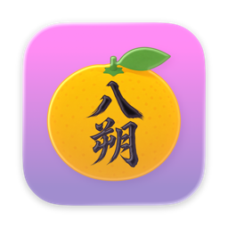

<p align="center"></p>

# Hassaku — Homebrew tap

> Many segments, one recording.

Install **Hassaku**, a macOS app that records several live sources — Android devices, one iPhone/iPad
and specific Mac app windows — side by side into a single MP4, with their audio mixed in.

Hassaku は、複数の Android 端末・iPhone/iPad（1 台）・Mac のウィンドウの映像と音声を 1 本の MP4 にまとめる macOS アプリです。

> This directory is the **source** for the public tap repo `idonuntius/homebrew-hassaku`.
> At release time its contents (`Casks/`, this `README.md`, `icon.png`) are copied there, and the
> notarized DMG is attached to the repo's release.

## Install

```sh
brew tap idonuntius/hassaku
brew install --cask hassaku
```

The app is signed with Developer ID and notarized by Apple. It bundles Google's `adb`
(Android SDK Platform-Tools; its license notices are under **Help** in the app).

## Update

```sh
brew update
brew upgrade --cask hassaku
```

## Uninstall

```sh
brew uninstall --cask hassaku          # add --zap to also remove its settings
```

## Requirements

- macOS 14 (Sonoma) or newer
- **Android**: Android 11+, USB debugging enabled and this Mac authorized
- **iPhone / iPad**: connected over **USB** and this Mac trusted
- **Mac windows**: allow Hassaku in System Settings → Privacy & Security → **Screen Recording**

Recordings and screenshots are saved to `~/Movies/Hassaku/` by default.
